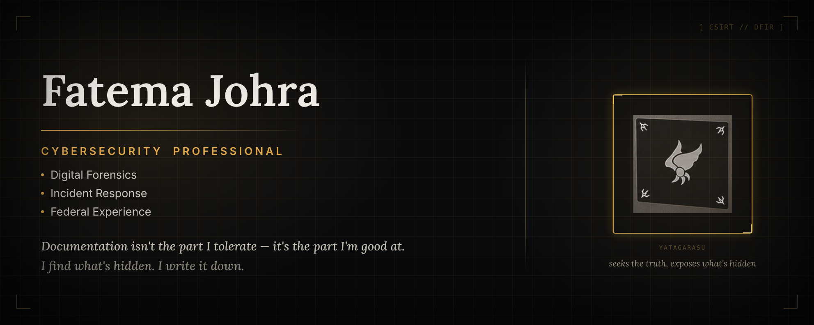

Federal Cybersecurity | Incident Response | Cyber Defense | Digital Forensics (DFIR)

## About

I got into digital forensics because I like puzzles where the evidence is already there — you just have to go find it. These days that's phishing campaigns, compromised accounts, and systems that quietly stopped behaving right. I follow evidence until the story makes sense. For seven years that's meant incident response and digital forensics mostly as a federal contractor: triaging alerts, leading incident response, building the CSIRT documentation and testing programs the team actually uses. It started with a DHS Cyber Crime Center internship and graduate research at George Mason University, and I've been chasing that same kind of problem ever since - the same thing that got me into it: a problem where the answer is sitting in the data, if you're willing to go find it!

## Portfolio

[Cybersecurity Portfolio](https://github.com/ftj258/cybersecurity-portfolio) — incident response playbooks, CSIRT procedures, tabletop exercises, incident reports, cloud security workflows, digital forensics documentation, and governance frameworks

[DFIR Home Labs](https://github.com/ftj258/dfir-home-labs) — self-directed practice labs (memory forensics, SIEM detection, cloud IR, and more) using free public tools and datasets

[Site](https://ftj258.github.io) — full resume-style portfolio site

## Contact

[LinkedIn](https://linkedin.com/in/fjohra)
